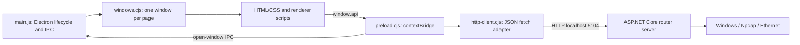

# WANT · Router Desktop

An **Electron** desktop interface for the [WANT Router Server](https://github.com/Gh0st3r0k/Router-Server). Manage the educational router through local REST calls while keeping renderer pages isolated from Node.js APIs.

The client is a management interface. Packet capture, forwarding, ARP, RIP, and DHCP run in the server, not in Electron.

## Contents

- [Features](#features)
- [Architecture](#architecture)
- [Requirements](#requirements)
- [Installation and startup](#installation-and-startup)
- [Testing](#testing)
- [Project layout](#project-layout)
- [Limitations and troubleshooting](#limitations-and-troubleshooting)

## Features

| Window | Implemented controls |
| --- | --- |
| Main | Inspect routes and interface summaries; add direct or next-hop routes; remove routes; add connected routes from configured interfaces; open management windows. |
| Ports | Edit router-model IPv4 addressing/display names, send ARP requests, toggle Proxy ARP and RIP per interface. |
| ARP | Inspect/flush the cache, change server cache TTL and client refresh interval. |
| RIP | Edit RIP timers and enable/disable RIP on interfaces. |
| DHCP | Edit global timing, create/update/delete pools, manage manual MAC reservations, inspect leases and filter them by pool. |

Main, Ports, RIP, and DHCP views refresh relevant tables periodically; the ARP view has a configurable refresh interval. Protocol state is stored by the server in memory and is lost on server restart.

## Architecture



Every window uses `contextIsolation: true` and `nodeIntegration: false`. The preload exposes explicit management methods through `window.api`; renderer pages do not import Node.js modules. The preload's `sandbox: false` setting permits its CommonJS helper import. The main process limits window creation to known local pages and focuses an existing window instead of opening duplicates.

See [client and API design](docs/development.md) for component contracts, duration units, and test boundaries. The authoritative [REST reference](https://github.com/Gh0st3r0k/Router-Server/blob/main/docs/api.md) and [network behavior](https://github.com/Gh0st3r0k/Router-Server/blob/main/docs/networking.md) live with the server.

## Requirements

- **Node.js 22+** and npm for development and the built-in Node test runner. Electron is installed from `package-lock.json` (Electron 38).
- A graphical Windows, Linux, or macOS desktop for the normal Electron UI; a virtual X display is sufficient for Linux smoke tests.
- A running router server on the same host at **`http://localhost:5104`**.
- Windows, Npcap, and suitable physical Ethernet adapters on the server host for actual network routing. Linux can run the server API/UI and hardware-independent tests, but its adapter discovery is intentionally disabled.
- Network access to the npm registry and Electron's GitHub release downloads during installation. No client API keys or database are required.

## Installation and startup

```sh
git clone https://github.com/Gh0st3r0k/ROUTER-CLIENT.git
cd ROUTER-CLIENT
npm ci
```

In the server checkout, start the compatible backend:

```sh
dotnet run --project Server/Server.csproj --launch-profile http
```

Then, from this client checkout:

```sh
npm start
```

Start with **Ports** to configure the server's interface model, then add connected/static routes from the main window. Use RIP and DHCP only on the intended lab networks. Interface address edits do not change the host OS network configuration.

## Testing

### Unit and contract tests

```sh
npm test
```

Tests use Node's built-in test runner and require no graphical display or running backend. They cover HTTP verbs/body serialization, empty successful mutation responses, HTTP/network errors, all preload endpoint mappings, window reuse, and rejection of unknown pages. GitHub Actions runs `npm ci` and `npm test` on Linux.

There is no compilation or bundling step: Electron runs the JavaScript and HTML directly. `npm start` plus the integration smoke test validates the runtime workflow.

### Electron + server smoke test

Start a **disposable local backend** on port 5104, then run:

```sh
npm run test:smoke
```

The test launches Electron with a loopback-only debugging port (9223 by default), exercises API calls through the actual preload bridge, creates/removes a temporary route and disabled DHCP pool/reservation, changes/restores timing settings, and checks all five windows. It terminates its Electron process on completion. It does not send ARP packets, enable RIP, or activate a DHCP pool. Do not run it against a shared router session: global timing values are temporarily modified. Set `ROUTER_DEBUG_PORT` if 9223 is occupied.

On a Linux CI host with Xvfb:

```sh
xvfb-run -a npm run test:smoke
```

For the isolated cloud container where Chromium's setuid/user-namespace sandbox is unavailable, use the explicit opt-in:

```sh
ROUTER_ELECTRON_NO_SANDBOX=1 xvfb-run -a npm run test:smoke
```

This opt-in disables the Chromium sandbox for the test process. Normal desktop startup uses the default sandbox configuration. Do not expose the debugging port or use untrusted remote renderer content.

## Project layout

```text
main.js                  Electron lifecycle and open-window IPC
windows.cjs              Window configuration, allowlist, reuse
preload.cjs              Renderer-facing window.api methods
http-client.cjs          Shared HTTP serialization/status handling
main.html                Routes and navigation
ports.html               Interface configuration and protocol toggles
arp.html                 ARP cache view
rip.html                 RIP timer and interface controls
dhcp.html                DHCP pools, reservations, leases
test/                    Node unit and API-contract tests
scripts/smoke.mjs        Actual Electron/backend integration check
docs/development.md      Component contracts and limitations
```

`node_modules/`, generated packages, logs, caches, and local environment files are ignored. No packaged installers or release pipeline are currently defined.

## Limitations and troubleshooting

| Symptom | Explanation / action |
| --- | --- |
| Empty tables or failed requests | Start the server first and confirm `http://localhost:5104/api/routes` responds. Some views show an empty table after fetch failures; inspect DevTools/console for the actual error. |
| Server runs on another host/port | The API base URL is fixed in `preload.cjs`; there is no runtime server selector. Keep the default server endpoint for the supported workflow. |
| Empty Ports on Linux | Expected server limitation: physical adapter discovery uses Windows WMI. |
| `window.api` is missing in a browser | Open the app with Electron. A regular browser does not execute the preload bridge. |
| Electron fails to download behind a proxy | Use the existing HTTPS proxy and `ELECTRON_GET_USE_PROXY=1 npm ci`. In read-only-home environments, also direct `XDG_CACHE_HOME`, `XDG_CONFIG_HOME`, and `electron_config_cache` to writable locations. Keep TLS verification enabled. |
| Linux display error | Start a desktop session or use Xvfb. Install the GTK/NSS/audio/GBM runtime libraries required by Electron. |
| Chromium sandbox startup failure in a container | Prefer a host with a supported sandbox. Only for the isolated cloud development container, use the explicit smoke-test opt-in above or `npm start -- --no-sandbox`. |
| Addressing, routes, or leases vanish | The server keeps configuration in memory; restarting it resets state. |

There is no login, durable configuration, remote-server selection, or production security boundary. Physical forwarding, Proxy ARP, RIP convergence, and DHCP behavior with real hosts require a Windows/Npcap hardware lab; successful UI/API checks alone do not validate those functions.
